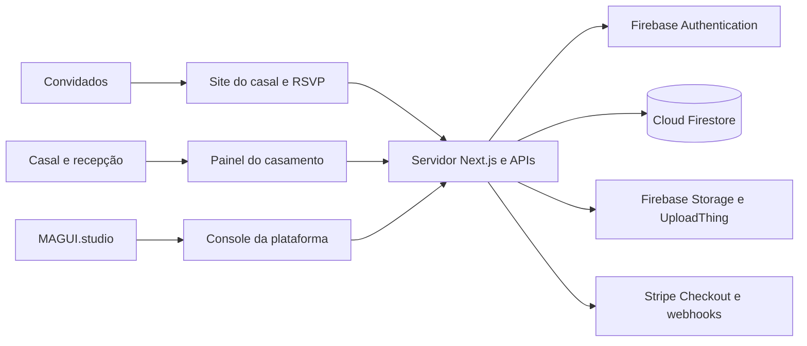

<div align="center">
  <picture>
    <source media="(prefers-color-scheme: dark)" srcset="public/forever/logo_white.svg" />
    
  </picture>

# Forever — Sites de casamento e gestão de convidados

Um endereço para celebrar sua história.

**Sites personalizados · RSVP · Convites digitais · Organização da recepção**

[Conheça o Forever](https://forever.magui.studio) · [Repositório](https://github.com/MAGUI-studio/Forever) · [Documentação técnica](docs/forever.md)

Desenvolvido pela **MAGUI.studio**.
</div>

---

O **Forever** reúne a experiência pública do casamento e as ferramentas de organização em uma aplicação web. Os casais personalizam o site, compartilham convites e acompanham as confirmações; a equipe de recepção organiza mesas e registra chegadas conforme o plano e os módulos habilitados.

Cada casamento possui seu próprio endereço em `forever.magui.studio/{slug}`, conteúdo, convidados e permissões. Um console exclusivo da MAGUI.studio permite administrar os casamentos da plataforma.

## 📌 Sumário

- [Stack tecnológica](#stack)
- [Funcionalidades](#funcionalidades)
- [Arquitetura e estrutura](#arquitetura)
- [Execução local](#execucao)
- [Rotas principais](#rotas)
- [Segurança e acesso](#seguranca)
- [Validação](#validacao)
- [Publicação e repositório](#publicacao)
- [Documentação](#documentacao)

## <a id="stack"></a>🛠️ Stack tecnológica

<div align="center">
  
  
  
  
  
  
  
  
  
  
</div>

Ícones de [TechIcons](https://github.com/gui-bus/TechIcons), selecionados entre as tecnologias presentes neste repositório.

| Camada | Tecnologias e uso |
| --- | --- |
| Aplicação | **Next.js 16**, App Router, **React 19** e **TypeScript 5** |
| Interface | **Tailwind CSS 4**, Radix UI, Phosphor Icons e Lucide |
| Movimento | **GSAP** e **Framer Motion** para transições e animações |
| Formulários | **React Hook Form**, **Zod** e Nuqs para estado na URL |
| Dados e identidade | **Firebase Authentication**, **Cloud Firestore** e Firebase Admin SDK |
| Mídia | **UploadThing** para a galeria e **Firebase Storage** para imagens do site |
| Pagamentos da plataforma | **Stripe Checkout** e webhooks para contratação e upgrade |
| Convites e localização | **jsPDF**, QR Code e **Leaflet** |
| Desenvolvimento | **Node.js 24**, npm e **ESLint 9** |

## <a id="funcionalidades"></a>💍 Funcionalidades

### Site do casal

- Templates com composições próprias: Botânico Clássico, Romance Contemporâneo e Minimalista Moderno, conforme a disponibilidade do plano.
- Editor visual com prévia, textos, cores, fotografias, data, local e publicação.
- História do casal, contagem regressiva, informações do evento, traje e lista de presentes.
- Galeria com até seis fotos e cinco estilos: Polaroid, Relicário, Varal, Película e Mural.
- Metadados de compartilhamento, URLs canônicas e sitemap para sites publicados.

### Convites e RSVP

- Convites individuais ou de família/grupo com links exclusivos.
- Confirmação por participante e edição das respostas enquanto o RSVP estiver aberto.
- Convites em PDF com QR Code e acompanhamento manual do envio.
- Busca, filtros, contadores e exportação de convidados no painel.

### Gestão e recepção

- Organização de mesas e lugares, check-in e contas para a equipe de recepção.
- Restrições alimentares e operação de buffet quando os módulos estiverem habilitados.
- Histórico de alterações e permissões por casamento.
- Console `/studio` para administrar casamentos, ciclo de vida e módulos da plataforma.

### Planos e presentes

O catálogo define os planos **Forever Essencial** e **Forever PRO**, além do upgrade entre eles. Preços e limites ficam em `src/config/pricing.ts`; as regras de acesso estão em `src/config/plan-access.ts`.

A contratação da plataforma utiliza Stripe. A lista de presentes do casal utiliza chave Pix e links externos configurados no editor; seu funcionamento é separado do checkout dos planos.

## <a id="arquitetura"></a>🏛️ Arquitetura e estrutura

Páginas públicas, painéis autenticados e APIs pertencem ao mesmo projeto Next.js. O servidor valida a sessão e o vínculo com o casamento antes de acessar os dados pelo Firebase Admin SDK.



```text
src/
├── app/                 Páginas, layouts e rotas de API
│   ├── [slug]/          Site e painel de cada casamento
│   ├── api/             RSVP, administração, checkout e integrações
│   └── studio/          Console MAGUI.studio
├── components/          Interface da plataforma e templates
├── config/              Marca, planos, módulos e templates
├── lib/                 Serviços, validações e regras compartilhadas
└── types/               Tipos de domínio
public/                  Logos, fontes e imagens dos templates
scripts/                 Administração, migração e utilitários
tests/                   Testes de regras de convidados
docs/                    Documentação técnica e operacional
```

No Firestore, `weddings/{slug}` concentra a configuração do casamento. Convites, membros, equipe de recepção, configurações e histórico ficam em subcoleções. O `slug` identifica o contexto; a autorização depende da sessão e das permissões verificadas no servidor.

## <a id="execucao"></a>🚀 Execução local

**Pré-requisitos:** Node.js **24.x**, npm e credenciais de um projeto Firebase. Uploads e contratação exigem também a configuração das respectivas integrações.

```bash
git clone https://github.com/MAGUI-studio/Forever.git
cd Forever
npm ci
```

Copie `.env.example` para `.env.local` e preencha as variáveis. No PowerShell:

```powershell
Copy-Item .env.example .env.local
```

| Grupo | Configuração |
| --- | --- |
| Firebase público | `NEXT_PUBLIC_FIREBASE_API_KEY`, `NEXT_PUBLIC_FIREBASE_AUTH_DOMAIN`, `NEXT_PUBLIC_FIREBASE_PROJECT_ID` |
| Firebase servidor | `FIREBASE_PROJECT_ID`, `FIREBASE_CLIENT_EMAIL`, `FIREBASE_PRIVATE_KEY` |
| Administração da plataforma | `MAGUI_ADMIN_UIDS` |
| Imagens | `FIREBASE_STORAGE_BUCKET`, `UPLOADTHING_TOKEN` |
| Endereço local | `NEXT_PUBLIC_SITE_URL=http://localhost:3000` |
| Contratação | `NEXT_PUBLIC_STRIPE_PUBLISHABLE_KEY`, `STRIPE_SECRET_KEY`, `STRIPE_WEBHOOK_SECRET` |

Consulte `.env.example` para os campos opcionais. `FIREBASE_ADMIN_UIDS` é reservado à migração legada; o acesso atual aos casamentos utiliza vínculos de membros.

```bash
npm run dev
```

Abra [localhost:3000](http://localhost:3000). Configure Authentication, Firestore e o operador da plataforma conforme [docs/forever.md](docs/forever.md). Os casamentos possuem configuração própria no banco; o conteúdo legado de Giovanna e Edson está isolado no script de migração.

> O utilitário `npm run stripe:listen` lê especificamente `.env` e encaminha eventos de teste para a porta **3001**. Para usá-lo, configure esse arquivo e execute o Next.js nessa porta com `npm run dev -- --port 3001`.

## <a id="rotas"></a>🧭 Rotas principais

| Rota | Finalidade |
| --- | --- |
| `/` | Apresentação do Forever |
| `/contratar` | Contratação de plano |
| `/login` | Acesso e recuperação de senha |
| `/studio` | Administração da plataforma |
| `/studio/modules?wedding={slug}` | Configuração de módulos do casamento |
| `/{slug}` | Site público do casal |
| `/{slug}/presentes` | Lista de presentes |
| `/{slug}/rsvp` | Confirmação por convite |
| `/{slug}/admin` | Painel do casamento |
| `/{slug}/admin/site` | Editor visual do site |
| `/api/webhooks/stripe` | Recebimento de eventos de pagamento |

## <a id="seguranca"></a>🔐 Segurança e acesso

- Autenticação pelo Firebase e validação de permissões no servidor, com escopo por casamento.
- Acesso direto do cliente ao Firestore bloqueado pelas regras em `firestore.rules`.
- Credenciais administrativas e segredos restritos ao servidor, sem prefixo `NEXT_PUBLIC_`.
- Convites acessados por códigos exclusivos, compartilhados somente com os destinatários.
- Páginas privadas e links de RSVP excluídos da indexação; sitemap limitado à página inicial e aos casamentos publicados.
- Sites em rascunho, suspensos ou arquivados indisponíveis para o fluxo público de RSVP.

Exportações contêm dados de convidados e códigos de acesso. As orientações de operação, backup e migração estão na documentação técnica. O check-in depende de conexão com a internet.

## <a id="validacao"></a>🧪 Validação

`npm run format` remove comentários dispensáveis e formata o código com Prettier.
Diretivas de ferramentas, anotações de tipos e avisos de licença são preservados;
dependências, arquivos gerados e instruções de ferramentas não são alterados.

```bash
npm run format
npm run format:check
npm run strip-comments
```

```bash
npm run lint
npx tsc --noEmit
npm run test:guests
npm run build
```

Os testes de convidados utilizam banco simulado. A validação completa de autenticação, persistência, uploads e checkout exige ambientes configurados e testes das integrações.

Depois de gerar o build, execute `npm run start` para iniciar o servidor de produção localmente.

## <a id="publicacao"></a>🌐 Publicação e repositório

O endereço de produção configurado no código é [forever.magui.studio](https://forever.magui.studio). A aplicação requer hospedagem compatível com o servidor Next.js e suas APIs. Configure as variáveis de ambiente, o domínio autorizado no Firebase Authentication e o endpoint de webhook antes de validar a implantação.

O repositório oficial é [MAGUI-studio/Forever](https://github.com/MAGUI-studio/Forever), e a branch de produção adotada pelo projeto é `main`.

Para atualizar um clone anterior à transferência:

```bash
git remote set-url origin https://github.com/MAGUI-studio/Forever.git
git remote -v
```

Confira também se a integração Git da hospedagem está conectada a `MAGUI-studio/Forever` e possui acesso ao repositório da organização.

## <a id="documentacao"></a>📚 Documentação

| Documento | Conteúdo |
| --- | --- |
| [Plataforma Forever](docs/forever.md) | Modelo de dados, permissões, módulos, templates, mídia e migração |
| [Planos](docs/PLANOS.md) | Regras e recursos dos planos |
| [Localização dos templates](docs/localizacao-dos-templates.md) | Organização dos arquivos de cada template |
| [Auditoria de conteúdo](docs/auditoria-conteudo-templates.md) | Revisão do conteúdo dos templates |
| [Guia legado de convidados](docs/COMO-USAR.md) | Histórico da configuração original e roteiros de RSVP; contém instruções anteriores à plataforma |

---

<div align="center">
  <strong>Forever by MAGUI.studio</strong><br />
  Tecnologia para celebrar histórias e organizar encontros.
</div>
